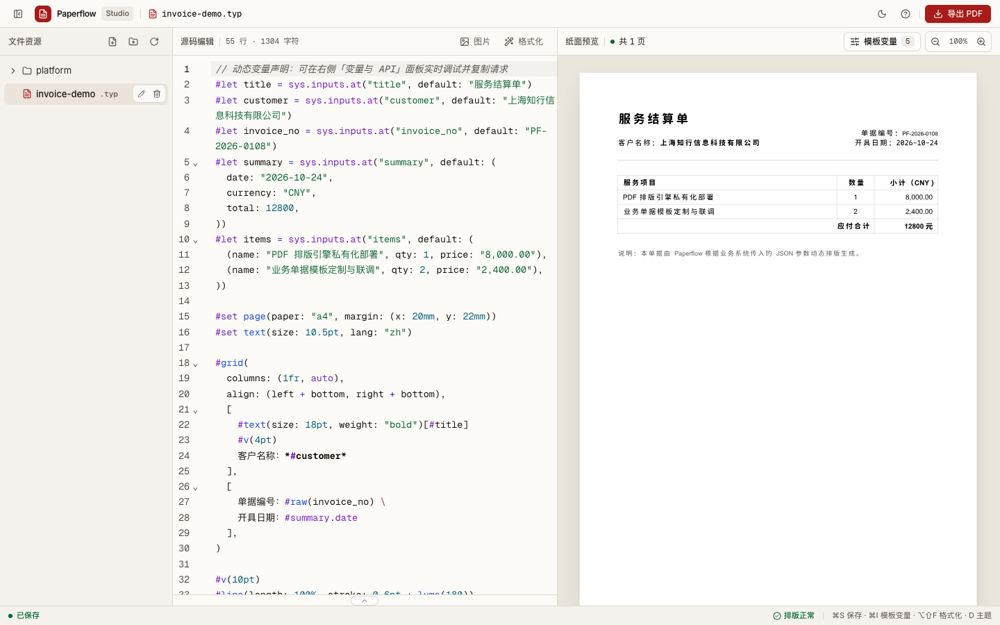
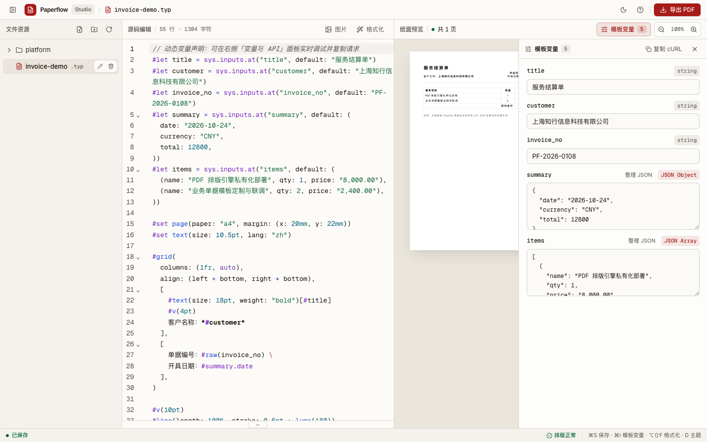
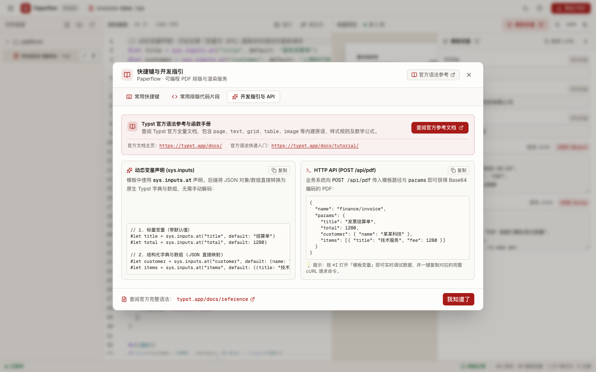
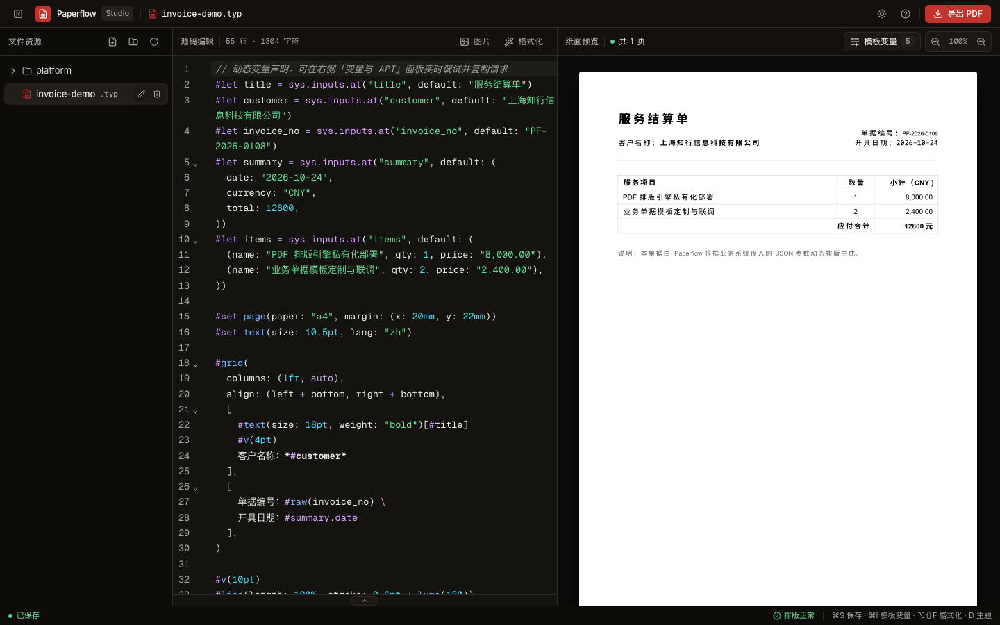
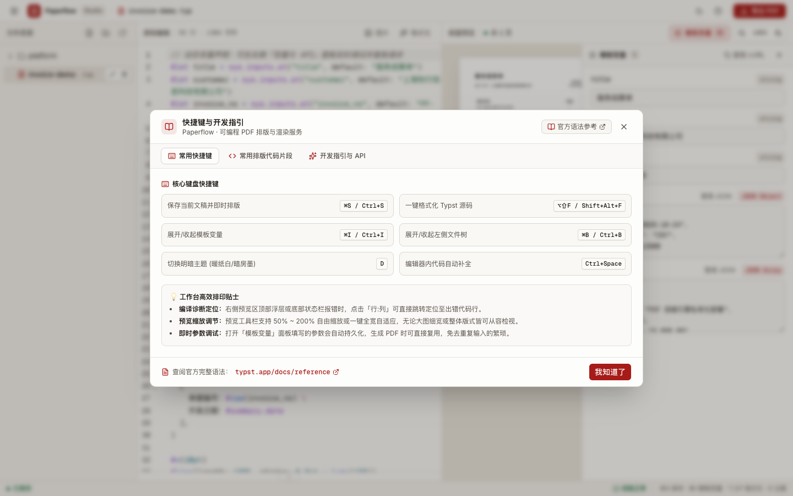

# Paperflow

<div align="center">

**面向技术团队的可编程 Typst 排版与 PDF 动态生成基础设施**

*“The Typesetter’s Proofing Desk · 活字排印校样台”*

[](https://www.rust-lang.org/)
[-black?logo=next.js)](https://nextjs.org/)
[](https://typst.app/)
[](#)

[快速开始](#-快速开始) • [界面展示](#-界面展示) • [核心特性](#-核心特性) • [系统架构](#-系统架构) • [API 接口指南](#-api-接口指南) • [模板语法规范](#-typst-模板编写规范)

<br />

<p align="center">
  
</p>

</div>

---

## 🖼️ 界面展示

| 功能场景 | 界面截图 |
| :--- | :--- |
| **实时校样工作台**<br>· 左侧多级模板文件树与快速操作<br>· 中央 CodeMirror 语法高亮、折叠与格式化<br>· 右侧 WASM 毫秒级纯白矢量纸面预览与自由缩放 |  |
| **模板变量调试抽屉**<br>· 自动识别源码中的 `sys.inputs`<br>· 支持数值、字符串与复杂 JSON 字典/数组<br>· 参数修改即时重绘，右上角直出一键复制 cURL 契约 |  |
| **开发指引与 API 契约**<br>· 生产环境 `POST /api/pdf` 接口规范映射<br>· 动态变量 `sys.inputs` 声明规范与 JSON 映射说明<br>· 内置 Typst 官方语法参考直达，研发排版契约对齐 |  |
| **暗房深色主题 (Dark Mode)**<br>· 按 `D` 键快速切换暗色工作台<br>· 严格遵循 **纯白校样铁律**，纸面不反相染灰<br>· 降低长时间模板调试视觉疲劳 |  |
| **快捷键与常用排版代码片段**<br>· 核心键盘快捷键速查 (`⌘S` / `⌥⇧F` / `⌘I` / `⌘B`)<br>· 常用排版代码片段（双栏信头、结构化表格、动态页码）<br>· 工作台高效排印贴士，支持一键复制代码 |  |

---

## 📖 项目简介

**Paperflow** 是一套专为研发与技术运营团队打造的 **可编程 PDF 排版与动态渲染服务**。它将现代排版语言 **[Typst](https://typst.app/)** 的极致性能与类似 IDE 的在线交互体验无缝融合。

### 为什么选择 Paperflow？

在业务系统中动态生成高保真单据、结算单、报告、证书或合同时，传统方案往往面临诸多痛点：

| 方案 | 优势 | 痛点 |
| :--- | :--- | :--- |
| **无头浏览器 (Puppeteer / Playwright)** | HTML/CSS 上手快 | 内存消耗极高、启动慢、分页断页行为难以精确控制、容器内字体与环境配置繁琐 |
| **LaTeX** | 排版精美 | 语法晦涩、编译缓慢、宏包依赖地狱、API 化集成极重 |
| **Overleaf / Typst.app** | 在线协作好 | 定位为学术论文写作或个人排版，无法直接对接业务系统 API 做高并发动态数据填充 |
| **Paperflow** ✨ | **毫秒级渲染、所见即所得、API 契约外显、开箱即用中文支持** | **专为业务系统 PDF 生成基础设施而生** |

---

## ✨ 核心特性

- ⚡ **双核排印引擎**
  - **前端毫秒级实时校样**：基于 `@myriaddreamin/typst.ts` WASM 编译器，在浏览器端直接将 Typst 编译为高保真 SVG 矢量页面，输入即排版。
  - **后端高并发原生渲染**：采用 Rust (Axum + `typst-embed`) 原生运行时，内存开销极低，单次 PDF 渲染通常仅需十几毫秒至几十毫秒。
- 🧩 **动态变量即 API 契约**
  - 自动识别模板源码中的 `sys.inputs.at(...)` 变量声明。
  - 深度支持原生 JSON 映射：标量自动转换、JSON Object 直转 Typst 字典（Dictionary）、JSON Array 直转 Typst 数组。
  - 提供交互式「模板变量」抽屉，修改参数即时重排并持久化保存，抽屉右上角支持一键生成与复制对应的真实 `cURL` 请求命令。
- 🎨 **“活字排印校样台” 专业质感**
  - 严谨的排印工作台美学（暖白道林纸、亚麻书脊与铅字浓墨色阶，朱砂印泥单点聚焦交付）。
  - **纯白校样铁律**：无论在日间还是暗房深色模式下，排出的文档纸张始终维持纯白底色与真实物理投影，杜绝色彩失真。
  - **自由视口缩放**：右侧预览工具栏支持 50% ~ 200% 自由放缩与一键重置，从容应对整版校样与微观字体排印细节检视。
- 🀄 **开箱即用中文字体支持**
  - 内置精选商用友好中英文字体（微软雅黑、宋体、Maple Mono 等宽中文编程字体、Roboto、Arial 等）。
  - 后端自动扫描字库并为前端 WASM 提供按需字体下发，彻底告别中文排版乱码或缺字方块。
- 🛠️ **一体化模板与资产工作区**
  - **树状文件系统**：支持模板分类归档、多级目录、新建、重命名与物理删除。
  - **图片资产抽屉**：支持拖拽与批量上传图片，轻点缩略图即可直接在源码光标处插入 `#image(...)` 语法；支持内联重命名（后端重命名物理文件并同步替换源码引用），删除前会提示当前模板中的引用次数，避免预览/导出因图片缺失而失败。
- 💻 **专业的代码编写体验**
  - 基于 CodeMirror 6，内置 Typst 语法高亮、快捷补全（`Ctrl+Space`）。
  - 集成 `@typstyle` WASM，支持快捷键一键美化格式化源码（`⌥⇧F` / `Shift+Alt+F`）。
  - 悬浮式编译诊断浮层，错误与警告精准定位到行号，点击即可直达出错代码。

---

## 🏗️ 系统架构

```
┌────────────────────────────────────────────────────────────────────────┐
│                          前端 Web Studio (Next.js 16)                  │
│                                                                        │
│   ┌────────────────────┐   ┌───────────────────┐  ┌────────────────┐  │
│   │  CodeMirror 编辑器  │──▶│ Typst WASM 编译器 │─▶│   矢量 SVG     │  │
│   │ (高亮 / 格式化 / 补全)│   │  (@myriaddreamin) │  │ (纯白看版纸面)  │  │
│   └────────────────────┘   └───────────────────┘  └────────────────┘  │
│             │                        ▲                                 │
│             ▼                        │ 加载字体/图片                   │
│   ┌────────────────────┐             │                                 │
│   │ 变量与 API 契约面板 │             │                                 │
│   │ (参数调试 / cURL)  │             │                                 │
│   └────────────────────┘             │                                 │
└─────────────┬────────────────────────┼─────────────────────────────────┘
              │ 保存模板 / 上传图片    │ 获取字体资源
              ▼                        │
┌──────────────────────────────────────┴─────────────────────────────────┐
│                          后端 API 服务 (Rust / Axum)                   │
│                                                                        │
│   • POST /api/pdf          • POST /api/nodes/rename                    │
│   • GET/PUT /api/files     • GET/POST/DELETE /api/images               │
│   • GET/DELETE /api/nodes  • GET /api/fonts & /fonts/*                 │
│                                                                        │
│   ┌────────────────────────────────────────────────────────────────┐   │
│   │                 Rust Typst 嵌入式渲染引擎                       │   │
│   │   JSON 变量转换器 (inputs.rs) ➔ typst-embed ➔ 标准 PDF 字节流   │   │
│   └────────────────────────────────────────────────────────────────┘   │
│                                      │                                 │
│                                      ▼                                 │
│                   本地持久化存储 (`./data/typst`, `./fonts`)            │
└──────────────────────────────────────┬─────────────────────────────────┘
                                       ▲
                                       │ POST /api/pdf (JSON 参数)
                                       │ 返回 { filename, contentBase64 }
                                       │
                      ┌────────────────┴────────────────┐
                      │    外部业务系统 (Java/Go/Node/Python)   │
                      └─────────────────────────────────┘
```

---

## 🚀 快速开始

### 方式一：Docker Compose 一键启动（推荐）

确保本地已安装 Docker 和 Docker Compose，在项目根目录下执行：

```bash
docker compose up -d
```

- **Web 编辑器**：[http://localhost:3000](http://localhost:3000)
- **后端 API**：[http://localhost:4000](http://localhost:4000)
- **数据持久化**：模板与图片持久化挂载至宿主机 `./data` 目录。

### 方式二：本地开发调试

确保本地已安装 **Rust (>= 1.85 / 2024 edition)**、**Node.js (>= 20)** 与 **pnpm**。

本仓库提供了 `justfile` 快捷指令（需安装 `just`）：

```bash
# 1. 安装前后端所有依赖
just setup

# 2. 同时启动后端与前端（支持热更新）
just dev
```

或手动分终端启动：

```bash
# 终端 1：启动 Rust 后端服务（监听 127.0.0.1:4000）
cargo run

# 终端 2：启动 Next.js 前端服务（监听 127.0.0.1:3000）
cd app
pnpm dev
```

打开浏览器访问 [http://localhost:3000](http://localhost:3000) 即可开始排版。

### 方式三：单进程一体化生产部署

Paperflow 后端支持直接托管前端 Next.js 静态导出产物，实现单二进制交付：

```bash
# 一键编译前端静态文件并打包后端 release 二进制
just build-all

# 单进程启动完整服务（http://127.0.0.1:4000 同时提供前端 UI 与 API）
just serve
```

---

## 🔌 API 接口指南

业务系统只需在模板排版完成后，调用核心接口即可实时获取 PDF 文件流。

### 核心接口：按模板生成 PDF

- **接口地址**：`POST /api/pdf`
- **请求头**：`Content-Type: application/json`
- **请求体（JSON）**：

```json
{
  "name": "invoice-demo",
  "params": {
    "title": "服务结算单",
    "customer": "上海知行信息科技有限公司",
    "invoice_no": "PF-2026-0108",
    "summary": {
      "date": "2026-10-24",
      "currency": "CNY",
      "total": 12800
    },
    "items": [
      {
        "name": "PDF 排版引擎私有化部署",
        "qty": 1,
        "price": "8,000.00"
      },
      {
        "name": "业务单据模板定制与联调",
        "qty": 2,
        "price": "2,400.00"
      }
    ]
  }
}
```

> 💡 **参数说明**：
> - `name`：模板在工作区中的相对路径，**不包含** `.typ` 后缀。例如根目录模板直接传 `"invoice-demo"`，子目录传 `"finance/monthly-report"`。
> - `params`：注入模板中的动态数据字典，对应模板中的 `sys.inputs`。

- **成功响应（200 OK）**：

```json
{
  "filename": "invoice-demo.pdf",
  "contentBase64": "JVBERi0xLjcKJYCAgIAKCjEgMCBvYmoKPDwvVHlwZS9QYWdlcy..."
}
```

将 `contentBase64` 进行标准 Base64 解码即为标准的二进制 PDF 字节流。

---

### 多语言调用示例

#### cURL
```bash
curl -X POST 'http://127.0.0.1:4000/api/pdf' \
  -H 'Content-Type: application/json' \
  -d '{
    "name": "invoice-demo",
    "params": {
      "title": "技术服务结算单",
      "customer": "示范企业"
    }
  }' \
  | jq -r .contentBase64 | base64 --decode > output.pdf
```

#### Node.js / TypeScript
```typescript
import fs from "node:fs/promises";

async function renderInvoice() {
  const res = await fetch("http://127.0.0.1:4000/api/pdf", {
    method: "POST",
    headers: { "Content-Type": "application/json" },
    body: JSON.stringify({
      name: "invoice-demo",
      params: {
        title: "技术服务结算单",
        customer: "示范企业",
      },
    }),
  });

  const { filename, contentBase64 } = await res.json();
  const pdfBuffer = Buffer.from(contentBase64, "base64");
  await fs.writeFile(filename, pdfBuffer);
  console.log(`PDF 已生成: ${filename}`);
}
```

#### Python
```python
import base64
import requests

response = requests.post(
    "http://127.0.0.1:4000/api/pdf",
    json={
        "name": "invoice-demo",
        "params": {
            "title": "技术服务结算单",
            "customer": "示范企业"
        }
    }
)

data = response.json()
with open(data["filename"], "wb") as f:
    f.write(base64.b64decode(data["contentBase64"]))
```

---

### 其他工作区管理接口

| 方法 | 路径 | 描述 |
| :--- | :--- | :--- |
| `GET` | `/health` | 服务健康检查探针（返回 `{"status":"ok"}`） |
| `GET` | `/api/nodes` | 获取工作区模板文件与目录树 |
| `DELETE` | `/api/nodes?path=...` | 删除指定路径的文件或目录 |
| `POST` | `/api/directories` | 创建新目录（`{ "path": "dir-name" }`） |
| `GET` | `/api/files?path=...` | 获取模板 `.typ` 源码文本内容 |
| `PUT` | `/api/files?path=...` | 保存模板 `.typ` 源码（支持 `isNew` 参数） |
| `POST` | `/api/nodes/rename` | 重命名文件或目录（`{ "oldPath": "...", "newPath": "..." }`） |
| `GET` | `/api/images?path=...` | 列出绑定在当前模板下的图片资产 |
| `POST` | `/api/images` | 上传图片文件（`multipart/form-data`） |
| `DELETE` | `/api/images` | 删除绑定的图片资产 |
| `POST` | `/api/images/rename` | 重命名图片（`{ "path": "...", "name": "...", "newName": "..." }`，保留扩展名、校验重名） |
| `GET` | `/api/fonts` | 获取系统已扫描注册的中英文字体列表 |
| `GET` | `/fonts/*path` | 静态字体文件分发（供给前端 WASM 加载渲染） |

---

## 📝 Typst 模板编写规范

在 Paperflow 中编写模板极其简单自然，与原生 Typst 语法 100% 保持一致：

### 1. 声明动态变量 (`sys.inputs`)

Paperflow 后端会自动处理 JSON 类型转换，**无需手动执行繁琐的 `json.decode`**：

```typst
// 1. 标量变量（字符串、数值）
#let title = sys.inputs.at("title", default: "服务结算单")
#let invoice_no = sys.inputs.at("invoice_no", default: "PF-2026-001")

// 2. 结构化字典（API 直接传入 JSON 对象）
#let summary = sys.inputs.at("summary", default: (
  date: "2026-10-24",
  currency: "CNY",
  total: 12800,
))

// 3. 字典数组（API 直接传入 JSON 数组）
#let items = sys.inputs.at("items", default: (
  (name: "云端排版服务", qty: 1, price: "8,000.00"),
  (name: "单据模板定制", qty: 2, price: "2,400.00"),
))
```

### 2. 页面基础与中文排版设置

```typst
#set page(paper: "a4", margin: (x: 20mm, y: 22mm))
// 设置默认字体与中文环境
#set text(font: ("Microsoft YaHei", "Arial"), size: 10.5pt, lang: "zh")
```

### 3. 循环渲染动态列表

```typst
#table(
  columns: (1fr, 60pt, 80pt),
  align: (left, center, right),
  table.header([*服务项目*], [*数量*], [*金额*]),
  ..items.map(item => (
    item.name,
    str(item.qty),
    item.price,
  )).flatten()
)
```

### 4. 插入图片资产

在编辑器中打开图片资产抽屉并上传图片后，直接通过绝对虚拟路径引用：

```typst
#image("/assets/logo.png", width: 35%)
```

图片资产按模板隔离存储于 `images/<模板路径>/`。重命名图片时后端会重命名物理文件，前端同步将当前模板源码中的 `/assets/旧名` 引用替换为 `/assets/新名`；删除图片前会提示该图片在当前模板中被引用的次数，避免预览或导出 PDF 时因图片缺失而失败。

---

## ⌨️ 常用快捷键

在编辑器中操作时，支持以下生产力快捷键：

| 快捷键 (Mac) | 快捷键 (Windows/Linux) | 动作 |
| :--- | :--- | :--- |
| `⌘ + S` | `Ctrl + S` | 保存当前模板文件并即时排版 |
| `⌥ + ⇧ + F` | `Shift + Alt + F` | 格式化当前 Typst 源码 (Typstyle) |
| `⌘ + I` | `Ctrl + I` | 展开 / 收起「模板变量」抽屉 |
| `⌘ + B` | `Ctrl + B` | 展开 / 收起左侧文件树栏 |
| `D` | `D` | 切换深色（暗房看版）/ 浅色（道林暖白）主题 |
| `Ctrl + Space` | `Ctrl + Space` | 触发代码自动补全 |

---

## 📁 目录结构说明

```
Paperflow/
├── app/                        # 前端 Web Studio 应用 (Next.js 16)
│   ├── app/                    # Next.js App Router 页面与布局
│   ├── components/             # React 组件库
│   │   ├── studio/             # 编辑器核心组件 (编辑器、预览面板、文件树、变量面板等)
│   │   └── ui/                 # 基础 UI 控件 (按钮、输入框、弹窗等)
│   ├── lib/                    # 前端核心工具库
│   │   ├── api/                # 后端 RESTful API 客户端
│   │   └── typst/              # Typst WASM 运行时集成、语法补全、输入参数提取与诊断
│   ├── public/                 # 静态资源与 WASM 二进制文件
│   └── package.json
│
├── src/                        # 后端服务源码 (Rust / Axum)
│   ├── main.rs                 # 服务入口、路由编排、静态文件伺服与状态管理
│   ├── pdf.rs                  # POST /api/pdf 渲染实现与任务调度
│   ├── inputs.rs               # JSON 数据到 Typst Value 字典的高效类型转换器
│   ├── files.rs                # 模板文件与目录树 CRUD 操作
│   ├── images.rs               # 图片资产上传与读取
│   ├── schema.rs               # 结构化 AST 模板定义
│   ├── translator.rs           # 模板 AST 转 Typst 源码翻译器
│   └── error.rs                # 统一 API 错误处理
│
├── fonts/                      # 内置中英文字体库 (微软雅黑、宋体、Maple Mono、Roboto 等)
├── data/                       # 数据持久化目录 (包含模板 typst 文件与图片资产)
├── Cargo.toml                  # Rust 依赖声明
├── justfile                    # 开发构建快捷脚本
├── Dockerfile                  # 后端 Dockerfile
├── docker-compose.yml          # Docker Compose 一键编排文件
└── DEPLOY.md                   # 详细部署文档
```

---

## ⚙️ 环境变量配置

系统支持以下环境变量，可在 `.env` 文件或 Docker 容器中配置：

### 后端环境变量

| 变量名 | 默认值 | 说明 |
| :--- | :--- | :--- |
| `PAPERFLOW_DATA_DIR` | `data` (容器内为 `/data`) | 模板、图片与包缓存存储的本地根目录 |
| `PAPERFLOW_FONTS_DIR` | `fonts` (容器内为 `/fonts`) | 系统字体所在目录 |
| `PAPERFLOW_FRONTEND_DIR` | `app/out` | 前端静态页面目录（生产一体化部署时使用） |
| `RUST_LOG` | `paperflow=info,tower_http=info` | 日志过滤级别 |

### 前端环境变量

| 变量名 | 默认值 | 说明 |
| :--- | :--- | :--- |
| `BACKEND_URL` | `http://localhost:4000/api` | **运行时**后端 API 地址（页面加载时动态注入，无需重新构建容器镜像） |
| `NEXT_PUBLIC_API_URL` | `http://127.0.0.1:4000/api` | **构建时**本地开发回退 API 地址 |

> 📌 **运行时动态注入原理**：Next.js 服务端在首屏 HTML 中动态注入 `<script>window.__BACKEND_URL__ = "..."</script>`，因此前端容器镜像只需构建一次，即可通过不同环境变量连接任意后端环境。

---

## 📄 开源许可证

本项目基于 [MIT License](LICENSE) 开源。
